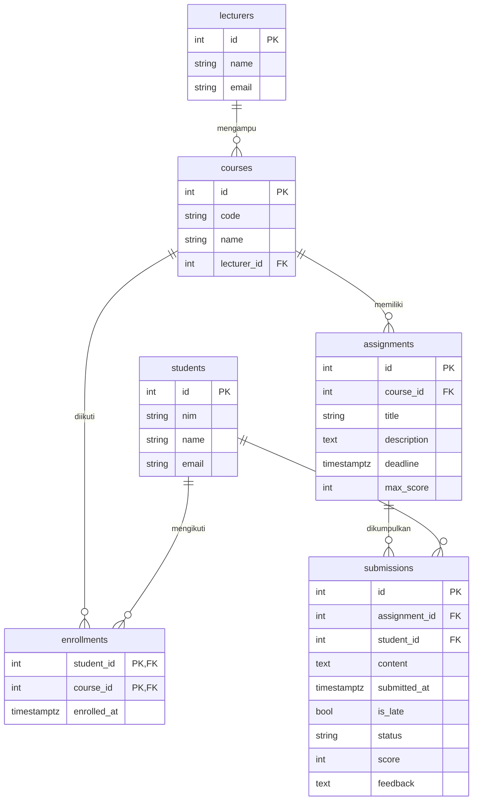

# REST API Sistem Pengolahan Data Tugas Mahasiswa

Tugas Akhir Learning Labs: Backend Development.

## 1. Deskripsi Project

REST API untuk mengelola dan mengolah data tugas mahasiswa: data **dosen**, **mahasiswa**, **mata kuliah** (beserta pendaftaran mahasiswa), **tugas** yang diberikan dosen, dan **pengumpulan tugas** oleh mahasiswa. Sistem otomatis menandai pengumpulan yang terlambat (melewati deadline), memvalidasi bahwa mahasiswa terdaftar di mata kuliah terkait, mendukung penilaian oleh dosen, serta menyediakan **rekap data** (rata-rata, nilai tertinggi/terendah, daftar yang belum mengumpulkan, laporan progres per mahasiswa).

**Teknologi:** Node.js, Express, PostgreSQL (Neon/Supabase), Vercel.

## 2. ERD / Skema Database

6 tabel: `lecturers`, `students`, `courses`, `enrollments`, `assignments`, `submissions`.



Relasi: one-to-many (`lecturers`→`courses`, `courses`→`assignments`, `assignments`→`submissions`, `students`→`submissions`) dan many-to-many (`students`↔`courses` lewat pivot `enrollments`).

**Gambar ERD (wajib):** buka https://dbdiagram.io, tempel DBML berikut, export PNG, simpan sebagai `erd.png`.

```dbml
Table lecturers {
  id serial [pk]
  name varchar(100) [not null]
  email varchar(150) [not null, unique]
}
Table students {
  id serial [pk]
  nim varchar(20) [not null, unique]
  name varchar(100) [not null]
  email varchar(150) [not null, unique]
  created_at timestamptz
}
Table courses {
  id serial [pk]
  code varchar(20) [not null, unique]
  name varchar(150) [not null]
  lecturer_id int [not null, ref: > lecturers.id]
}
Table enrollments {
  student_id int [ref: > students.id]
  course_id int [ref: > courses.id]
  enrolled_at timestamptz
  indexes { (student_id, course_id) [pk] }
}
Table assignments {
  id serial [pk]
  course_id int [not null, ref: > courses.id]
  title varchar(200) [not null]
  description text
  deadline timestamptz [not null]
  max_score int [not null, default: 100]
  created_at timestamptz
}
Table submissions {
  id serial [pk]
  assignment_id int [not null, ref: > assignments.id]
  student_id int [not null, ref: > students.id]
  content text [not null]
  submitted_at timestamptz
  is_late boolean [default: false]
  status varchar(20) [default: 'submitted']
  score int
  feedback text
  indexes { (assignment_id, student_id) [unique] }
}
```

## 3. URL Deployment

`https://NAMA-PROJECT.vercel.app` (ganti dengan URL Vercel kamu). Di bawah, `BASE_URL` = URL tersebut.

## 4. Daftar Endpoint

Semua request/response berformat JSON; untuk POST/PUT/PATCH gunakan header `Content-Type: application/json`.
Format error: `{"error": "pesan"}`. Status error umum: `400` input salah, `404` tidak ditemukan, `409` duplikat / relasi bermasalah, `500` error server.
Status sukses: `200` (GET/PUT/PATCH/DELETE), `201` (POST).

### Info API
- Method: GET | URL: `BASE_URL/`
- Response (200): `{"message":"REST API Sistem Pengolahan Data Tugas Mahasiswa","resources":[...]}`

---
### A. Dosen (`/lecturers`)

### Lihat Semua Dosen
- Method: GET | URL: `BASE_URL/lecturers`
- Response (200): `{"data":[{"id":1,"name":"Dr. Ratna Sari","email":"ratna@kampus.ac.id"}]}`

### Lihat Detail Dosen
- Method: GET | URL: `BASE_URL/lecturers/1`
- Response (200): `{"data":{"id":1,"name":"Dr. Ratna Sari","email":"ratna@kampus.ac.id"}}`
- Error (404): `{"error":"Dosen tidak ditemukan"}`

### Tambah Dosen
- Method: POST | URL: `BASE_URL/lecturers` | Headers: Content-Type: application/json
- Request Body: `{"name":"Dr. Ani","email":"ani@kampus.ac.id"}`
- Response (201): `{"message":"Dosen berhasil ditambahkan","data":{"id":3,"name":"Dr. Ani","email":"ani@kampus.ac.id"}}`
- Error (400): `{"error":"Field email tidak valid"}`
- Error (409): `{"error":"Data duplikat (sudah ada data dengan nilai yang sama)"}`

### Ubah Sebagian Data Dosen
- Method: PATCH | URL: `BASE_URL/lecturers/3` | Headers: Content-Type: application/json
- Request Body: `{"name":"Dr. Ani Wijaya"}`
- Response (200): `{"message":"Dosen berhasil diperbarui","data":{...}}`
- Error (400): `{"error":"Kirim minimal satu field: name, email"}`
- Error (404): `{"error":"Dosen tidak ditemukan"}`

### Hapus Dosen
- Method: DELETE | URL: `BASE_URL/lecturers/3`
- Response (200): `{"message":"Dosen berhasil dihapus"}`
- Error (409): `{"error":"Operasi ditolak: data referensi tidak ditemukan atau masih dipakai data lain"}` (dosen masih mengampu mata kuliah)
- Error (404): `{"error":"Dosen tidak ditemukan"}`

---
### B. Mahasiswa (`/students`)

### Lihat Semua Mahasiswa
- Method: GET | URL: `BASE_URL/students` (opsional `?q=andi` cari nama/NIM)
- Response (200): `{"data":[{"id":1,"nim":"L0124001","name":"Andi Pratama","email":"andi@student.ac.id","created_at":"..."}]}`

### Lihat Detail Mahasiswa
- Method: GET | URL: `BASE_URL/students/1`
- Response (200): `{"data":{"id":1,"nim":"L0124001","name":"Andi Pratama","email":"andi@student.ac.id"}}`
- Error (404): `{"error":"Mahasiswa tidak ditemukan"}`

### Tambah Mahasiswa
- Method: POST | URL: `BASE_URL/students` | Headers: Content-Type: application/json
- Request Body: `{"nim":"L0124004","name":"Dewi","email":"dewi@student.ac.id"}`
- Response (201): `{"message":"Mahasiswa berhasil ditambahkan","data":{"id":4,"nim":"L0124004",...}}`
- Error (400): `{"error":"Field nim wajib diisi"}`
- Error (409): `{"error":"Data duplikat (sudah ada data dengan nilai yang sama)"}`

### Ubah Sebagian Data Mahasiswa
- Method: PATCH | URL: `BASE_URL/students/4` | Headers: Content-Type: application/json
- Request Body: `{"name":"Dewi Lestari"}`
- Response (200): `{"message":"Mahasiswa berhasil diperbarui","data":{...}}`
- Error (404): `{"error":"Mahasiswa tidak ditemukan"}`

### Hapus Mahasiswa
- Method: DELETE | URL: `BASE_URL/students/4`
- Response (200): `{"message":"Mahasiswa berhasil dihapus"}`
- Error (409): `{"error":"Operasi ditolak: ..."}` (mahasiswa sudah punya pengumpulan tugas)
- Error (404): `{"error":"Mahasiswa tidak ditemukan"}`

### Laporan Progres Mahasiswa
- Method: GET | URL: `BASE_URL/students/1/report`
- Deskripsi: Rekap semua tugas dari mata kuliah yang diikuti mahasiswa
- Response (200): `{"data":{"student":{"id":1,"nim":"L0124001","name":"Andi Pratama"},"summary":{"total_assignments":2,"submitted":1,"not_submitted":1,"late":0,"graded":1,"average_score":85,"average_percentage":85},"assignments":[{"assignment_id":1,"title":"Program Kasir C","course_code":"IF101","deadline":"...","max_score":100,"submission_id":1,"status":"graded","is_late":false,"score":85}]}}`
- Error (404): `{"error":"Mahasiswa tidak ditemukan"}`

---
### C. Mata Kuliah (`/courses`)

### Lihat Semua Mata Kuliah
- Method: GET | URL: `BASE_URL/courses`
- Response (200): `{"data":[{"id":1,"code":"IF101","name":"Pemrograman Dasar","lecturer_id":1,"lecturer":"Dr. Ratna Sari","student_count":3}]}`

### Lihat Detail Mata Kuliah
- Method: GET | URL: `BASE_URL/courses/1`
- Response (200): `{"data":{"id":1,"code":"IF101",...}}`
- Error (404): `{"error":"Mata kuliah tidak ditemukan"}`

### Tambah Mata Kuliah
- Method: POST | URL: `BASE_URL/courses` | Headers: Content-Type: application/json
- Request Body: `{"code":"IF103","name":"Jaringan Komputer","lecturer_id":1}`
- Response (201): `{"message":"Mata kuliah berhasil ditambahkan","data":{"id":3,...}}`
- Error (400): `{"error":"Field lecturer_id wajib berupa angka"}`
- Error (409): `{"error":"Operasi ditolak: data referensi tidak ditemukan atau masih dipakai data lain"}` (lecturer_id tidak ada)

### Ubah Mata Kuliah
- Method: PUT | URL: `BASE_URL/courses/3` | Headers: Content-Type: application/json
- Request Body: `{"code":"IF103","name":"Jaringan Komputer Lanjut","lecturer_id":2}`
- Response (200): `{"message":"Mata kuliah berhasil diperbarui","data":{...}}`
- Error (404): `{"error":"Mata kuliah tidak ditemukan"}`

### Hapus Mata Kuliah
- Method: DELETE | URL: `BASE_URL/courses/3`
- Response (200): `{"message":"Mata kuliah berhasil dihapus"}`
- Error (409): `{"error":"Operasi ditolak: ..."}` (masih punya tugas)
- Error (404): `{"error":"Mata kuliah tidak ditemukan"}`

### Lihat Mahasiswa pada Mata Kuliah
- Method: GET | URL: `BASE_URL/courses/1/students`
- Response (200): `{"data":[{"id":1,"nim":"L0124001","name":"Andi Pratama","email":"...","enrolled_at":"..."}]}`
- Error (404): `{"error":"Mata kuliah tidak ditemukan"}`

### Daftarkan Mahasiswa ke Mata Kuliah
- Method: POST | URL: `BASE_URL/courses/2/students` | Headers: Content-Type: application/json
- Request Body: `{"student_id":3}`
- Response (201): `{"message":"Mahasiswa berhasil didaftarkan ke mata kuliah","data":{"student_id":3,"course_id":2,"enrolled_at":"..."}}`
- Error (404): `{"error":"Mahasiswa tidak ditemukan"}`
- Error (409): `{"error":"Data duplikat (sudah ada data dengan nilai yang sama)"}` (sudah terdaftar)

### Keluarkan Mahasiswa dari Mata Kuliah
- Method: DELETE | URL: `BASE_URL/courses/2/students/3`
- Response (200): `{"message":"Mahasiswa berhasil dikeluarkan dari mata kuliah"}`
- Error (404): `{"error":"Mahasiswa tidak terdaftar pada mata kuliah ini"}`

---
### D. Tugas (`/assignments`) — resource utama, CRUD lengkap

### Lihat Semua Tugas
- Method: GET | URL: `BASE_URL/assignments` (opsional `?course_id=1`, `?upcoming=true`)
- Response (200): `{"data":[{"id":1,"course_id":1,"title":"Program Kasir C","description":"...","deadline":"...","max_score":100,"course_code":"IF101","course_name":"Pemrograman Dasar"}]}`
- Error (400): `{"error":"course_id harus berupa angka"}`

### Lihat Detail Tugas
- Method: GET | URL: `BASE_URL/assignments/1`
- Response (200): `{"data":{"id":1,...}}`
- Error (404): `{"error":"Tugas tidak ditemukan"}`

### Tambah Tugas
- Method: POST | URL: `BASE_URL/assignments` | Headers: Content-Type: application/json
- Request Body: `{"course_id":1,"title":"Tugas Array","description":"Kerjakan soal 1-5","deadline":"2026-11-30T23:59:00+07:00","max_score":100}` (`description` & `max_score` opsional)
- Response (201): `{"message":"Tugas berhasil ditambahkan","data":{"id":3,"title":"Tugas Array",...}}`
- Error (400): `{"error":"Field title wajib diisi"}`

### Ubah Seluruh Data Tugas
- Method: PUT | URL: `BASE_URL/assignments/3` | Headers: Content-Type: application/json
- Request Body: `{"course_id":1,"title":"Tugas Array & Pointer","description":"Soal 1-8","deadline":"2026-12-05T23:59:00+07:00","max_score":100}`
- Response (200): `{"message":"Tugas berhasil diperbarui","data":{...}}`
- Error (404): `{"error":"Tugas tidak ditemukan"}`

### Ubah Sebagian Data Tugas
- Method: PATCH | URL: `BASE_URL/assignments/3` | Headers: Content-Type: application/json
- Request Body: `{"deadline":"2026-12-10T23:59:00+07:00"}`
- Response (200): `{"message":"Tugas berhasil diperbarui","data":{...}}`
- Error (400): `{"error":"Field max_score harus bilangan bulat 1-1000"}`

### Hapus Tugas
- Method: DELETE | URL: `BASE_URL/assignments/3`
- Deskripsi: Pengumpulan terkait ikut terhapus
- Response (200): `{"message":"Tugas berhasil dihapus"}`
- Error (404): `{"error":"Tugas tidak ditemukan"}`

### Rekap Data Satu Tugas
- Method: GET | URL: `BASE_URL/assignments/1/summary`
- Response (200): `{"data":{"id":1,"title":"Program Kasir C","deadline":"...","max_score":100,"total_students":3,"total_submissions":1,"late_submissions":0,"graded":1,"average_score":85,"highest_score":85,"lowest_score":85,"not_submitted":2,"not_submitted_students":[{"id":2,"nim":"L0124002","name":"Siti Rahma"}]}}`
- Error (404): `{"error":"Tugas tidak ditemukan"}`

---
### E. Pengumpulan Tugas (`/submissions`)

### Lihat Semua Pengumpulan
- Method: GET | URL: `BASE_URL/submissions` (opsional `?assignment_id=1`, `?student_id=1`, `?status=graded|submitted`)
- Response (200): `{"data":[{"id":1,"assignment_id":1,"assignment_title":"Program Kasir C","max_score":100,"student_id":1,"nim":"L0124001","student_name":"Andi Pratama","content":"https://github.com/andi/kasir-c","submitted_at":"...","is_late":false,"status":"submitted","score":null,"feedback":null}]}`
- Error (400): `{"error":"status harus 'submitted' atau 'graded'"}`

### Lihat Detail Pengumpulan
- Method: GET | URL: `BASE_URL/submissions/1`
- Response (200): `{"data":{"id":1,...}}`
- Error (404): `{"error":"Pengumpulan tidak ditemukan"}`

### Kumpulkan Tugas
- Method: POST | URL: `BASE_URL/submissions` | Headers: Content-Type: application/json
- Request Body: `{"assignment_id":1,"student_id":2,"content":"https://github.com/siti/kasir-c"}`
- Deskripsi: `is_late` otomatis `true` jika melewati deadline
- Response (201): `{"message":"Tugas berhasil dikumpulkan","data":{"id":2,"is_late":false,"status":"submitted",...}}`
- Error (400): `{"error":"Mahasiswa tidak terdaftar pada mata kuliah tugas ini"}`
- Error (404): `{"error":"Tugas tidak ditemukan"}`
- Error (409): `{"error":"Data duplikat (sudah ada data dengan nilai yang sama)"}` (sudah mengumpulkan)

### Revisi Pengumpulan
- Method: PUT | URL: `BASE_URL/submissions/2` | Headers: Content-Type: application/json
- Request Body: `{"content":"https://github.com/siti/kasir-c-v2"}`
- Response (200): `{"message":"Pengumpulan berhasil diperbarui","data":{...}}`
- Error (400): `{"error":"Tugas sudah dinilai, tidak bisa diubah"}`
- Error (404): `{"error":"Pengumpulan tidak ditemukan"}`

### Nilai Pengumpulan (oleh Dosen)
- Method: PATCH | URL: `BASE_URL/submissions/2/grade` | Headers: Content-Type: application/json
- Request Body: `{"score":85,"feedback":"Bagus, tambahkan validasi input"}` (`feedback` opsional)
- Response (200): `{"message":"Nilai berhasil disimpan","data":{"id":2,"status":"graded","score":85,...}}`
- Error (400): `{"error":"Field score harus bilangan bulat 0-100"}`
- Error (404): `{"error":"Pengumpulan tidak ditemukan"}`

### Hapus Pengumpulan
- Method: DELETE | URL: `BASE_URL/submissions/2`
- Response (200): `{"message":"Pengumpulan berhasil dihapus"}`
- Error (404): `{"error":"Pengumpulan tidak ditemukan"}`

## 5. Menjalankan Secara Lokal

```bash
git clone <link-repo>
cd tugas-mahasiswa-api
npm install
cp .env.example .env        # isi DATABASE_URL dari Neon/Supabase
npm run db:init             # membuat tabel + data awal
npm run dev                 # http://localhost:3000
```

## 6. Deploy ke Vercel

1. Buat database PostgreSQL gratis di Neon atau Supabase, salin connection string.
2. Push project ke GitHub.
3. Di Vercel: **Add New > Project**, pilih repo.
4. Di **Settings > Environment Variables** tambahkan `DATABASE_URL` (jangan commit `.env`).
5. Deploy, lalu uji semua endpoint dengan Postman/Thunder Client memakai URL `*.vercel.app`.
6. Jalankan `npm run db:init` sekali dari lokal (dengan `DATABASE_URL` database online) untuk membuat tabel.
